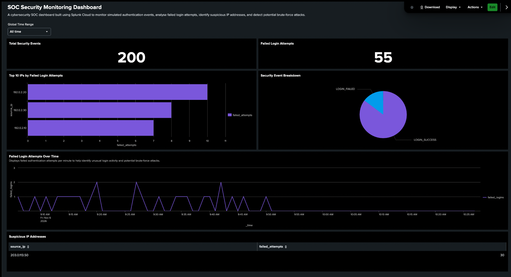

# Splunk SOC Security Monitoring Dashboard

A hands-on cybersecurity project using **Splunk Cloud, Python, and Splunk Processing Language (SPL)** to simulate, monitor, and analyse authentication events, identify suspicious IP addresses, and investigate potential brute-force attacks.

## Dashboard Preview



## Project Overview

This project demonstrates fundamental Security Operations Centre (SOC) skills, including:

- Security log generation and ingestion
- Log analysis using Splunk Cloud
- Failed authentication monitoring
- Suspicious IP address identification
- Brute-force detection using SPL
- Security dashboard development and visualisation

All authentication events were generated using Python for educational purposes. No real user credentials or production systems were involved.

## Technologies Used

- **Splunk Cloud** — Security event searching, analysis, and dashboards
- **Python** — Synthetic authentication log generation
- **SPL** — Security searches and detection logic
- **CSV** — Structured security event storage
- **GitHub** — Project documentation and version control

## Dashboard Features

| Visualisation | Description |
|---|---|
| Total Security Events | Displays the total number of ingested security events |
| Failed Login Attempts | Counts unsuccessful authentication attempts |
| Top 10 Failed Login IPs | Ranks source IP addresses by failed authentication attempts |
| Security Event Breakdown | Displays successful versus failed login events |
| Failed Login Attempts Over Time | Tracks unsuccessful logins across one-minute intervals |
| Suspicious IP Addresses | Identifies IP addresses exceeding the configured failed-login threshold |

## Security Findings

Analysis of the simulated dataset produced the following results:

| Metric | Result |
|---|---|
| Total security events | 200 |
| Failed login events | 55 |
| Suspicious IP address | `203.0.113.50` |
| Failed attempts associated with suspicious IP | 30 |
| Detection threshold | 5 failed logins within 1 minute |

The simulated suspicious IP address exhibited repeated failed authentication attempts, indicating potential brute-force behaviour.

The dashboard also identified other source IP addresses with unsuccessful login activity. These events provide useful context for distinguishing isolated authentication failures from more concentrated suspicious behaviour.

**Note:** The detection threshold is a demonstration rule, not a validated production alert threshold. Repeated failures warrant investigation but do not independently prove a malicious attack.

## Brute-Force Detection Logic

The following SPL query identifies source IP addresses generating five or more failed authentication events within a one-minute interval:

```spl
index=main sourcetype=csv source="security_logs.csv" event_type="LOGIN_FAILED"
| bin _time span=1m
| stats count AS failed_attempts BY _time source_ip
| where failed_attempts >= 5
| sort - failed_attempts
```

This query groups failed login events by time window and source IP, counts authentication failures, and filters results using a configurable threshold.

## Project Structure

```text
Splunk-SOC-Threat-Detection-Lab/
├── data/
│   └── security_logs.csv
├── reports/
│   └── SOC Security Monitoring Dashboard.pdf
├── screenshots/
│   └── soc_dashboard.png
├── spl_queries/
│   ├── brute_force_detection.spl
│   └── dashboard_queries.spl
├── generate_logs.py
└── README.md
```

## How to Reproduce

1. Install Python 3.
2. Run `python3 generate_logs.py` to generate the simulated authentication dataset.
3. Upload `data/security_logs.csv` into Splunk Cloud and configure timestamp extraction and CSV fields.
4. Run the searches documented in `spl_queries/`.
5. Create a Splunk Dashboard Studio dashboard using the search results.
6. Configure the visualisations and global time-range input.
7. Investigate suspicious IP addresses and failed login activity.

## Dashboard Report

The exported dashboard is available here:

[View SOC Security Monitoring Dashboard (PDF)](SOC%20Security%20Monitoring%20Dashboard.pdf)

## Skills Demonstrated

- SOC monitoring fundamentals
- Security event analysis
- Threat detection and investigation
- SPL query development
- Python scripting
- Security data visualisation
- Technical documentation

## Project Limitations

This is a simulated SOC environment, not a production security monitoring system. The dataset is synthetic, the detection thresholds are illustrative, and the dashboard does not establish malicious intent or automatically respond to threats.

Future improvements could include scheduled alerts, additional detection rules, longer-duration log analysis, and investigation workflows.
